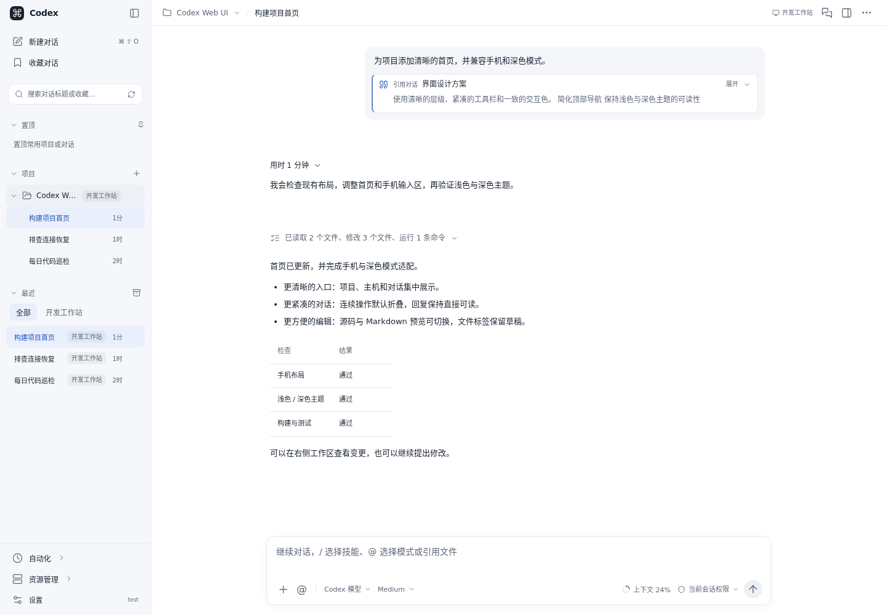
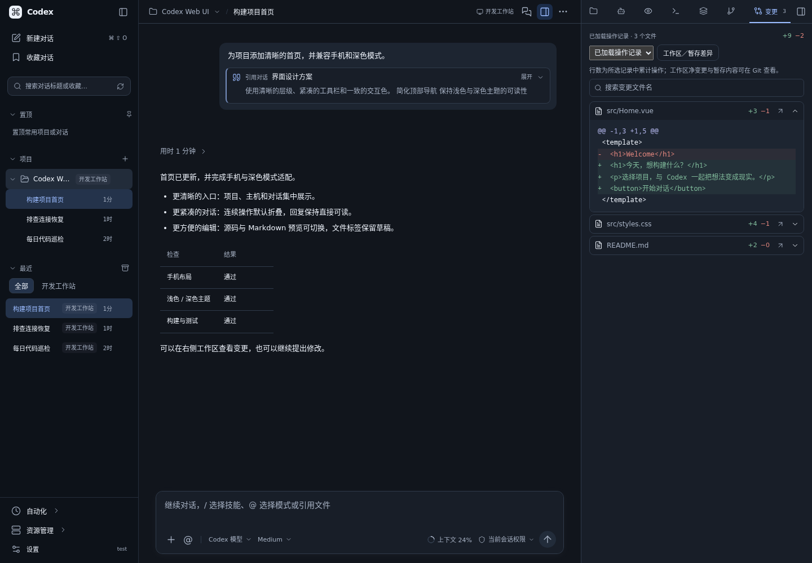
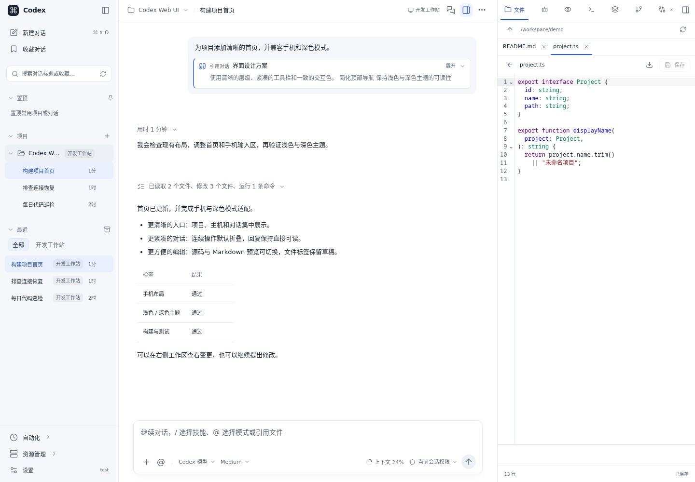
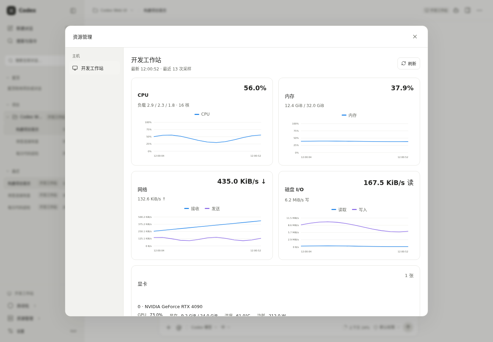
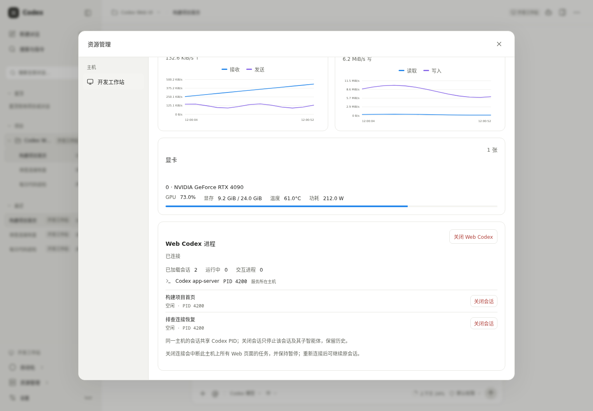
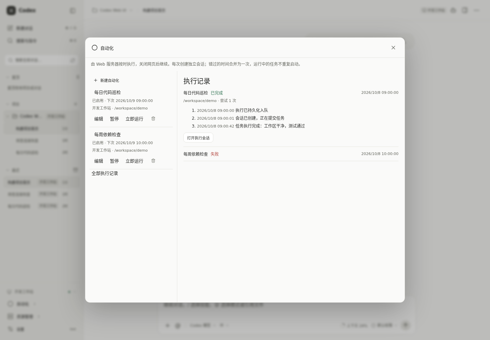
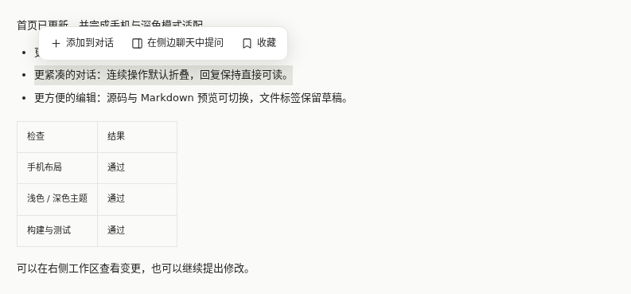
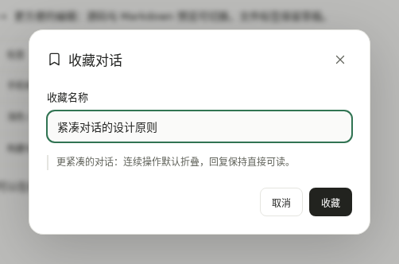
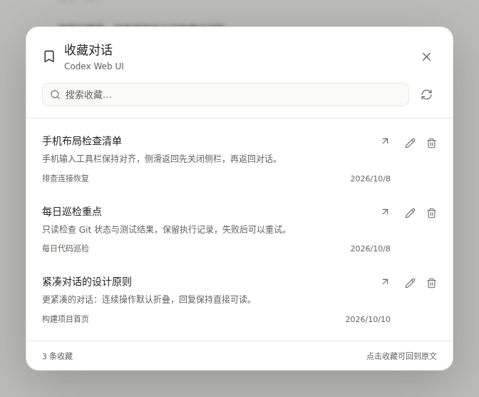
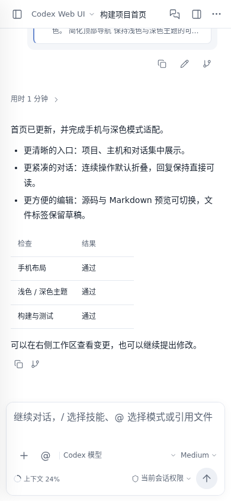

# Codex Web UI

[简体中文](README.md) · **English**

A Vue 3, TypeScript, and Node.js 22 web client for Codex, with desktop and mobile layouts. Conversations, history, forks, compaction, models, configuration, approvals, files, and terminals use the official **Codex app-server** protocol. The Node service authenticates browser access and bridges connections to local or SSH workstations.

This is an evolving desktop-style workflow, with implemented features and remaining limits listed below. An API supported by the protocol does not automatically mean its full desktop UI is implemented. See the [official app-server documentation](https://learn.chatgpt.com/docs/app-server).

## Screenshots

These images show the real Vue application with fixed demonstration data. They contain no real account, workstation, or private conversation data. Resource values and execution records illustrate the interface, not benchmark results. The current interface uses Chinese labels.

The interface uses white and cool gray surfaces, blue interaction accents, and a high contrast dark theme. Desktop headers are 42 px tall, with workspace navigation in the same row; mobile headers retain 48 px height and space for touch controls.

<table>
  <tr>
    <td align="center"><strong>Desktop chat and grouped activity</strong><br></td>
    <td align="center"><strong>Dark theme and changes</strong><br></td>
  </tr>
  <tr>
    <td align="center"><strong>Multi-file editor</strong><br></td>
    <td align="center"><strong>Host resource trends</strong><br></td>
  </tr>
  <tr>
    <td align="center"><strong>GPU and session connections</strong><br></td>
    <td align="center"><strong>Schedules and execution history</strong><br></td>
  </tr>
  <tr>
    <td align="center"><strong>Bookmark selected text</strong><br></td>
    <td align="center"><strong>Name a new bookmark</strong><br></td>
  </tr>
  <tr>
    <td colspan="2" align="center"><strong>Project bookmarks: search, rename, and jump to the original</strong><br></td>
  </tr>
</table>

<details>
<summary>Mobile layout</summary>

<p align="center"></p>

</details>

To regenerate, run `npm ci`, `npx playwright install chromium`, and `npm run docs:screenshots`. Use `npm run docs:screenshots -- --only=bookmarks` to update only the bookmark images. The script starts an isolated frontend with test protocol fixtures. It never connects to a real backend or runs a model, and the images are excluded from Docker images.

[Deployment](#docker-quick-start) · [Features and limits](#features-and-limits) · [Development](#development-and-validation) · [Code review and priorities](docs/project-audit.md)

Conversations can be moved between projects on the same host from their menu, using native project membership while retaining the working directory. Settings includes archived chat management for the selected host. Workspace files and unsaved drafts stay isolated by host and project when switching conversations. See [project membership](docs/native-projects.md) and [host settings](docs/host-settings.md).

## Docker quick start

Install Docker Engine/Desktop with Docker Compose v2, then run these commands from the repository directory:

```sh
cp deploy/docker/env.example .env.docker
chmod 600 .env.docker
mkdir -p workspace
```

Edit `.env.docker`: set `CODEX_WEB_PASSWORD` to a unique password of at least 12 characters and set `WORKSPACE_PATH` to your project directory. You can generate a password with `openssl rand -hex 24`. On Linux, the bind-mounted directory must be writable by the container's UID/GID `1000:1000`; choose a suitable directory or grant this user access to it.

```sh
docker compose --env-file .env.docker -f compose.yaml -f compose.local.yaml up -d --build
```

Open [http://127.0.0.1:8787](http://127.0.0.1:8787), sign in, and add an SSH machine with Codex installed under Settings → Connections. Select that host and its project. SSH-only deployment needs no CLI inside the container. The web password and Codex account login are separate.

If the deployment machine only hosts the web service, disable its Codex executor under **Settings → Connections → Local host**. The web service and SSH connections continue running. Local projects and history are retained and become available when you enable it again. Finish active tasks or terminals before disabling the executor. See [host settings](docs/host-settings.md#停用本机-codex).

For local Linux execution, reuse the host installation read-only. With npm, set `HOST_CODEX_DIRECTORY` in `.env.docker` to the complete `@openai` scope beneath `npm root -g`, along with the container entrypoint. For example:

```dotenv
HOST_CODEX_DIRECTORY=/usr/local/lib/node_modules/@openai
CODEX_BIN=/opt/host-codex/codex/bin/codex.js
```

Retain `-f compose.host-codex.yaml` in every command for that deployment:

```sh
docker compose --env-file .env.docker -f compose.yaml -f compose.local.yaml -f compose.host-codex.yaml up -d --build
docker compose --env-file .env.docker -f compose.yaml -f compose.local.yaml -f compose.host-codex.yaml exec app sh -c '"$CODEX_BIN" --version'
docker compose --env-file .env.docker -f compose.yaml -f compose.local.yaml -f compose.host-codex.yaml exec app sh -c '"$CODEX_BIN" login --device-auth'
```

Login uses the container's persistent `CODEX_HOME`; sharing an installation does not automatically share host account data. See [host Codex setup](docs/docker.en.md#reuse-the-host-codex-installation) for native Linux binaries, nvm paths, and account reuse. After a host/remote CLI upgrade, finish active tasks and restart the corresponding app-server; the web image needs no rebuild.

Standard Docker isolation can block the Linux namespaces required by Codex's sandbox; read-only/workspace-write commands encountered this limit in the tested container. For terminal, tmux, or model command tools, users can explicitly choose Codex Full access, which covers the mounts and SSH hosts accessible to the container. The deployment never changes permissions automatically or enables privileged mode. See [permission notes](docs/docker.en.md#validation-and-troubleshooting).

The non-root image includes Git, SSH, and tmux. Codex comes directly from an existing host or remote installation; the image neither bundles nor pins the CLI. Web metadata and container Codex configuration/history use separate persistent volumes, while SSH history stays on the remote workstation. The local overlay publishes only a loopback port. The base Compose file publishes no ports. In Docker, **Local** means the container, and `/workspace` is the mounted host directory. It does not automatically connect to a macOS/Windows desktop Codex process or use that desktop account's history.

For public access, use the Caddy HTTPS overlay, set the real domain and certificate contact, and follow [Docker deployment](docs/docker.en.md). That guide also covers SSH mounts, existing Codex data, upgrades, backups, and troubleshooting. Do not combine the local and public overlays.

## Mobile installation and background notifications

With a public HTTPS deployment, open **Settings → App and notifications** (the UI label is “应用与通知”) to install the PWA and explicitly enable notifications. Android Chrome supports the app's install button or the browser installation menu. On iOS/iPadOS 16.4+, use Safari's **Share → Add to Home Screen**, launch the installed app, and then enable notifications.

Standard Web Push can report completed replies, approvals/additional input, and failed runs while the page is closed or the phone is locked. The server and relevant Codex task must keep running. Device authorization and web login each last up to 30 days and are managed separately; explicit logout revokes subscriptions associated with that login, while a password change revokes other devices' authorizations. Notification titles show the conversation name and the body shows the event, excluding reply text, commands, and file paths. Force-stopping apps, power-saving policies, Focus modes, and OS notification settings can affect delivery; real Android/iPhone acceptance still requires the target devices.

VAPID keys are generated automatically and persisted in `DATA_DIR`, already covered by Docker's `webdata` volume. See the [PWA and notification guide](docs/pwa.en.md) / [简体中文](docs/pwa.md) for installation, updates, deployment settings, and device acceptance steps.

## Run with Node.js

Requires Node.js 22+. Local execution uses an existing executable CLI; SSH-only use requires Codex on the remote machine. Runtime compatibility checks include `codex-cli 0.163.0`; the application does not pin or automatically update it. See the [protocol notes](docs/protocol.md#codex-0163-兼容行为) for steering, restored permissions, and terminal replay. For this local example, configure Codex as the system user that will run the web service:

```sh
codex --version
codex login
npm ci
cp .env.example .env
npm run dev
```

Open [http://127.0.0.1:5173](http://127.0.0.1:5173); the backend listens on `127.0.0.1:8787`. If `CODEX_WEB_PASSWORD` is empty, the first start generates a random password, prints it in the backend terminal, and saves it to `.data/bootstrap-password.txt` with mode `0600`. You can instead set a password of at least 12 characters in `.env`.

Web login lasts up to 30 days; normal service restarts retain valid sessions when `DATA_DIR` persists. Under **Settings → Account → Web access → Change access password** (Chinese UI: “设置 → 账户 → 网页访问 → 修改访问密码”), enter the current password and confirm a new password of at least 12 characters. Saving keeps the current device signed in with a renewed session and revokes other devices' sessions and push authorizations. The password hash is stored in `DATA_DIR/web-password.json` with mode `0600`, taking precedence over `.env` and the initial password; later environment changes do not overwrite it. Docker's `webdata` volume persists changes. For recovery, see [password and login deployment notes](docs/docker.en.md#access-password-and-login).

The service inherits this user's Codex login and configuration. Account tokens belong on the workstation, not in frontend configuration. For a production build:

```sh
npm run build
npm start
```

Open [http://127.0.0.1:8787](http://127.0.0.1:8787). For a Linux host deployment, see the [deployment guide](docs/deployment.md), [Caddyfile](deploy/Caddyfile), and [systemd example](deploy/codex-web.service). Public deployments require HTTPS, a strong password, and the exact `PUBLIC_ORIGIN`.

## Features and limits

Implemented features have both protocol integration and UI. Environment-specific verification is recorded in the [validation checklist](docs/validation.md).

| Feature | Implementation | Limits |
| --- | --- | --- |
| Prompt presets | Manage 10 numbered slots in Settings; type `/`, a slot number, or a name to recall prompts and commands; save drafts and sync across browsers | Insertion retains drafts and attachments without sending; commands use existing Web actions; replacement/clearing requires confirmation. Separate from CLI `tui.presets`; [details](docs/prompt-presets.md) |
| Context compaction | Manual and automatic compaction, restored usage, a desktop/mobile usage menu such as `218k / 500k tokens` with an explicit compact action, in-progress reminders, completion markers at their original history position | Waits for completion events, not just the start acknowledgement; tapping the mobile indicator only opens details; Codex's own compaction remains controlled by its configuration/model |
| Conversation quotes and side chat | Source cards with expandable Markdown quotations; open a side chat with the full current context from the header, or quote selected message/source text in a separate read-only conversation | Hiding the panel or switching main threads keeps side answers and drafts; ending requires confirmation. Side conversations do not trigger completion push; [details](docs/selection-side-chat.md) |
| Conversation bookmarks | Bookmark selected message text with a custom name; the top-left Bookmarked conversations entry groups all bookmarks by project. Sidebar and `Ctrl/⌘ + K` search include saved names, excerpts, and source titles; project menus retain their scoped view | Scoped by host and project; older source messages load on demand; preserves chat titles and drafts, and retains excerpts if the source is reverted/deleted; [details](docs/selection-side-chat.md) |
| Conversation forks and copy | Native forks from the active chat or any host’s sidebar row, retaining history; copy a deep link, complete Markdown, or workspace path | New thread ID; active Goals wait for the next explicit input. Cannot truncate a currently running turn; copy keeps the selected chat and does not acquire its writer |
| Conversation math | User messages, replies and side chats support inline `$…$` / `\(...\)` and display `$$…$$` / `\[…\]` formulas; bundled fonts and horizontally scrollable long formulas | Supports KaTeX's LaTeX syntax. Code, prices, incomplete and invalid formulas retain their source; copying messages preserves the original formula text |
| Edit the last message | Pencil action, inline editor with independent file/image uploads, paste/drop, attachment removal, and cancel/resend; retains unchanged attachments and structured inputs in the same conversation | Requires a settled, paginated turn with a single user message; replaces that turn's reply without undoing commands or file changes |
| Projects and configuration | Read configuration layers/version/managed requirements; save with version checks; browse local/SSH folders; resolve native project identities and pass `projectId` when creating chats | Older CLIs retain directory mode. Desktop versions with client-local classifications still require moving chats in the desktop app; remote APIs cannot update that private state. See [project assignment](docs/native-projects.md) |
| SSH connections | Add/edit dialogs, private-key uploads and replacement, tests of unsaved settings; auto-discover Codex in the remote interactive login shell or specify its executable | Uploads accept unencrypted OpenSSH / PEM keys up to 64 KB; requires remote CLI/login; retrieve and confirm the fingerprint in the connection dialog, with explicit reconfirmation if it changes; tests check SSH, protocol initialization and configuration without model inference |
| Approvals | Commands, file changes, extra permissions, tool questions, and basic MCP input; pending requests shared across signed-in browsers on one host | First valid response wins; advanced MCP schemas and desktop host requests are not fully covered |
| Files and changes | Multiple tabs, line numbers, syntax highlighting, selected-code quotes/sidebar questions, Markdown source/preview, readable JSON Unicode previews, images and PDF pagination; streaming downloads and change counts | Up to 16 tabs and 8 MB per preview/edit; large file links open the containing folder for downloading originals without the preview size cap; SSH file viewing/downloads require Python 3; private drafts retain their original version for conflict checks; binary files are not text-edited; [workflow details](docs/automations-and-editor.md) |
| Office previews | Browser-local DOCX pages, XLSX/XLS worksheets, and PPTX slides, with pagination, zoom, and original downloads | Read-only, up to 8 MiB; no third-party upload; bounded decompression, parser timeout, and isolated document rendering. DOC/PPT offer downloads; complex layouts can differ from Office; [details](docs/office-preview.md) |
| Terminal and tmux | Multiple terminal tabs, new/close controls, PTYs, Tab completion, resize/reconnect, background output, copy/paste and mobile control keys; tmux management, pane snapshots, and durable cross-host once/permanent job monitoring with completion notifications | Prefer the user's interactive shell, then Bash. Completion comes from the shell. Switching views preserves terminals; tmux client closure only detaches, but container restart does not preserve running processes |
| Previews | Static HTML, URLs, and automatic local/SSH forwarding from a port number; HTTP/WebSocket, Vite HMR, desktop/mobile widths, copyable links and new tabs; workspace tab changes retain the preview | Targets the host's loopback HTTP service on ports 1024–65535; SSH must permit local forwarding; temporary links expire after at most 1 hour, logout, or closing the connection; verified with a real NAS SSH development service |
| Authentication | Password, persistent 30-day cookie sessions, password changes, CSRF, Origin checks, and login rate limits | Password changes keep the current device signed in and revoke others; normal restarts retain valid logins when DATA_DIR persists; single-user workstation without tenant isolation or SSO |
| Commands and shortcuts | `/` commands, `@` project-file references, page command palette | The web page must have focus; no system-wide wake shortcut |
| Host settings and reconnect | A shared host selector in Settings; scoped configuration and integrations; Performance refreshes CLI version, complete model catalogue and context configuration; Codex switches gateway URL/key or official device-code login | Settings do not switch the current chat. Reconnect/provider changes require idle turns, approvals and terminals. Proxy reconnect affects only the client. Gateway keys stay on the target host separately from official credentials; [details](docs/host-settings.md) |
| Models and permissions | Model/English reasoning-effort controls, persistent global read-only/default/full-access setting, per-conversation choices, named web presets, managed policy/provider capability display | Global changes apply to the next new turn, not an already running turn; managed restrictions still apply; listed models do not guarantee account access |
| Uploads | Up to 8 files per upload, 20 MB each; SSH uploads use private directories through the trusted SSH connection without the Codex sandbox; images use `localImage` | Remote hosts need Python 3 and write access to the project; local proxy writes retain the 16 MiB message cap. Other formats are passed by path, not guaranteed native model parsing |
| Conversations | Create with an immediate preview from the first accepted message, then automatically generate a concise title of up to 36 characters, resume/stop/steer, fork, rename, archive/restore, title-only search, export, pagination, drafts, and reading position | Content updates control recency; opening a chat does not reorder it; live desktop sharing requires the same daemon |
| Structured choices | Recommended options and explanations, Other, multiple questions, secret inputs, and page/notification reminders | Uses official `requestUserInput` requests; plain reply lists are not converted into forms; regular-mode support uses process/session configuration overrides without changing host configuration |
| Subagent workspace | Ancestor-scoped active/waiting/completed groups, automatic history prefetch for up to three children, live events, and paginated child conversations | Read-only metadata/history requests; does not resume child threads or switch the parent conversation; parent drafts remain intact |
| Output presentation | Hide entries without a public reasoning summary; entering or returning to a running chat expands its process and operation batches; collapse completed activity and show final answers directly | Individual command output and file diffs expand on demand; manual collapse survives live updates; approvals and failures remain visible; private reasoning content is not exposed |
| Sidebar | Pinned, Projects, and Recent across all hosts; device filters below Recent, project move-up/down controls with shared persistent order, and project context menus | Pinned projects and chats share a list sorted by latest content activity, showing 6 entries by default; regular projects and each project's chats show 4 by default; old history remains paginated |
| Sidebar and workspace layout | Drag the navigation sidebar's right edge or workspace's left edge, keyboard controls, double-click reset, separate browser-local width preferences | Widths are clamped to retain chat space; preview focus changes retain the dragged width; mobile keeps its navigation drawer and full-screen workspace; terminals resize with the panel |
| Conversation indicators | Orange while running, red on error, green when completed but unread; reading clears green across pinned, project, and recent rows | Read receipts persist on the Web server and synchronize across devices in real time, with recovery after reconnection or reopening; a new completed turn remains unread. Only thread/turn identities and content activity timestamps are shared |
| Conversation cache and restore | Show cached history immediately; fetch summary turns first and load process details in pages of 40 when expanded; flatten large timelines for virtualization and release reloadable old details/output; restore the last host/chat/draft on relaunch | Private snapshots are scoped to a valid login, bounded to 12 chats / 4 MiB / 24 hours, and cleared on logout; older Codex stores fall back to full reads, exports always fetch complete history, and sending waits for reconciliation; [large conversation loading](docs/large-conversation-sync.md) |
| Resource management | Secondary host menu above Settings, CPU/memory/network/disk charts, NVIDIA GPU utilization/VRAM and process user/PID/elapsed time/command, session names with Codex PIDs and per-session release/resume controls | Linux requires Python 3; GPU requires nvidia-smi; container metrics reflect visible resources, use SSH for full host metrics; per-session release preserves other tasks; releasing the entire host interrupts its Web tasks; release state persists across service restarts |
| Mobile UI / PWA | Chat drawer, full-screen workspace, consistent fonts/touch targets, themes, home-screen installation, manual update checks, and deferred updates during work | The Service Worker caches public UI assets only; private history uses a separate session cache; sending, approvals, and execution require a connection |
| Background notifications | Opt-in standard Web Push for completion, approval/additional input, and failures; category controls, test notification, and navigation to the correct host/chat | Device authorization up to 30 days; explicit logout revokes associated subscriptions; independent background reconnect and read-only recovery of tracked tasks after restart; server/tasks must remain running; [recovery](docs/background-notifications.md), [PWA acceptance](docs/pwa.en.md) |
| Git/worktrees | Branches, status, line diffs, stage/unstage, selected-file commits, create/import/switch worktrees | Runs on the selected host; commits only selected files and preserves unrelated staged files |
| Skills/Apps/MCP | Search available host/project Skills with `/`, send native skill references, and use existing Apps/MCP | Skills load separately for each host; no plugin marketplace; advanced OAuth and desktop-specific host capabilities need further work |
| Plan / Goal | Select Default, Plan, or Goal with `@`; native planning and persisted thread objectives, pause/resume/clear controls, and optional token budgets | Requires the selected Codex host's protocol and feature support; Plan pauses goal progress, Codex schedules continuation, and permission settings still apply |
| Scheduled automations | Daily, selected weekdays or interval schedules with host, directory, model, permissions and timezone; durable logs, pre-dispatch retries and outcome reconciliation | Server-side scheduling survives browser closure; no overlapping runs on one host; missed cycles coalesce; unknown native mutations require review before another run; [details](docs/automations-and-editor.md) |

## Desktop synchronization

By default, `CODEX_CONNECTION_MODE=spawn` starts `codex app-server --listen stdio://` as the service user and inherits `CODEX_HOME` (normally `~/.codex`). Codex persists non-ephemeral threads. Desktop Codex on the same machine, user, and data directory can read these histories; its list may need refreshing.

To connect to an already running daemon:

```dotenv
CODEX_CONNECTION_MODE=proxy
# Set only for a non-default control socket:
# CODEX_SOCKET_PATH=/absolute/path/app-server-control.sock
```

`proxy` uses `codex app-server proxy` and requires the matching daemon to exist. It does not start the desktop app or discover arbitrary private desktop sockets. Clients must connect to the same app-server process to share an active thread. Isolated real-daemon tests cover multiple clients, active shell turns, events, and bridge reconnects; the original desktop's active model turns and approvals still need validation in the target desktop environment. Proxy uses WebSocket-over-pipes and the daemon's 16 MiB unfragmented-message limit.

There is no automatic cross-machine cloud synchronization. A service on another server uses that server's history; SSH workstations use their own remote user's configuration and storage. Docker's default named `CODEX_HOME` volume is independent of desktop data. Read the [protocol guide](docs/protocol.md) and [Docker guide](docs/docker.en.md) before sharing existing data or connecting a daemon.

## Everyday workflow

- `Cmd/Ctrl + K`: command palette; `Cmd/Ctrl + Shift + O`: new chat; `Cmd/Ctrl + J`: terminal. `Enter` sends, `Shift + Enter` adds a line, and `Esc` closes panels.
- Type `/` to search commands and the selected host's Skills. Selecting a skill adds a reference token; sending includes `$skill-name` and its native skill path. Type or tap `@` for project files or Default, Plan, and Goal modes. On phones, tap a mode directly or dismiss the menu with its close button; selecting a mode preserves the unsent draft. Use the attachment button for files and images.
- Plan uses Codex's built-in planning mode. Goal saves the supplied objective on the current thread, with an optional positive integer token budget; leaving it empty adds no limit. Its card shows status and cumulative usage, with pause, resume, and clear controls. Wait for the current turn to finish or use Stop before changing modes. Switching to Plan pauses an active goal. Modes keep the chosen permissions.
- Codex continues a Goal while the thread is idle and eligible. Continuing after the web page closes requires its server and app-server to remain running. Plan turns, pending input, active work, or budget limits suppress continuation. Pausing prevents subsequent automatic turns; use **Stop** to interrupt a running turn. Native modes and goal APIs were verified against `0.159.2` and `0.160.0` with isolated mock providers. Hosts that lack or disable Goals show a capability message. See the [official Goal guide](https://developers.openai.com/cookbook/examples/codex/using_goals_in_codex) and [app-server protocol](https://learn.chatgpt.com/docs/app-server).
- Select a project and local/remote host above the new-chat composer. Draft text is retained when switching; attachments are uploaded again when changing hosts. Existing chats retain their original host and directory.
- Browse directories when adding a project; enter an absolute path and press Enter to navigate directly. Browsing another host does not switch the active chat.
- Right-click a project or use `…` to pin, edit, view bookmarks, archive chats, remove its web metadata, or show it in workspace files. Removing a project does not delete disk files. Use file download buttons to save originals.
- Click an image in a conversation to enlarge it without opening the workspace. The viewer supports zoom, original size, fit, Esc, and mobile Back. Dismiss a pending-question banner with its close button; the native question and answer draft remain available.
- After the first accepted message, new conversations reuse the host’s configured model and provider to generate a concise title asynchronously and persist it in native Codex. Titles survive reloads and appear across clients. The message preview remains while generation is pending or fails; manual renames take precedence. Temporary title requests stay out of the conversation list and completion notifications.
- The device buttons below Recent filter that list without changing the active workstation or project, and retain the choice across reloads. Sidebar and command search match only canonical titles; unnamed chats use the first 70 characters of the first preview line. Loaded matches appear immediately; other results come from title metadata pages cached for 30 seconds, capped at 128 pages with concurrent-request reuse. Rename, delete, and refresh invalidate the cache; message bodies and files are not searched.
- Conversation menus can fork on the source host or copy a deep link, complete paginated Markdown, or workspace path, preserving the current selection and draft. Native forks retain history and defer active Goal continuation until the next explicit input.
- Select text within one message and choose **Bookmark** (Chinese UI: “收藏”), then confirm its first name. Open **Bookmarked conversations** (“收藏对话”) at the top left to browse bookmarks grouped by project, or use a project menu for its bookmarks. Sidebar search and `Ctrl/⌘ + K` also search saved names, excerpts, and source conversation titles. You can search, rename, or remove bookmarks in the panel. Clicking one switches to its source conversation and highlights the text, loading older history on demand. Bookmark names do not change conversation titles or composer drafts. A reverted or deleted source keeps its saved excerpt and shows a location error.
- Expand overflow beyond 4 projects/chats with **Show more**, then collapse it again. The selected item remains visible.
- Drag the workspace edge or double-click to reset. Focus the edge and use arrow keys; hold Shift for larger steps, or use Home/End for minimum/maximum width.
- Use **Git** for branches, selected-file commits, and worktrees; **Tmux** for session management. Deleting a tmux session ends its processes and asks for confirmation.
- In **Preview → Development service**, enter a port and connect. **File / URL** also accepts `5173`, `localhost:5173`, or `http://localhost:5173/path` and forwards the selected host's service automatically. The target service uses HTTP; Codex Web itself can be accessed over HTTPS.
- Development previews support HTTP, WebSocket, and Vite HMR, and remain open across workspace tab changes. Copy a temporary URL or open it in a new tab; it expires after at most 1 hour, logout, or closing the connection. Forwarding runs through the Web server and does not bind a localhost port on the browser's device or proxy arbitrary Internet sites.
- Preview pages run in an isolated iframe. Upstream cookies are stored server-side for each preview connection, separately from Codex Web login cookies. Page storage is temporary and resets when the iframe reloads; Service Workers are unavailable. Apps with root-based routing may need a router `basename` / development-server base path, or HashRouter.
- Markdown files open in a rendered preview; select **Source** to edit and save, retaining drafts when switching views. **Preview → File / URL** also accepts Markdown or image paths. Relative project images and links use the selected host's files, while HTML keeps its isolated iframe preview.
- In **Settings → Connections**, use the up/down controls to save the order of local and SSH hosts; the recent-conversation device filters follow the same order. Reordering preserves the selected conversation and drafts. Add/edit SSH hosts and test before saving. Retrieve the server's SHA256 fingerprints in the web dialog and confirm **Trust and test connection** for a new host; changed keys require a separate replacement confirmation. Trust records persist in `DATA_DIR`, and subsequent connections keep strict key verification. Accept `host`, `user@host`, or SSH aliases; leave the port blank to use SSH configuration and the Codex path blank for automatic discovery. Identity paths are on the backend machine (inside Docker when deployed there).
- The new-chat project selector offers **Work outside a project**, retaining the host, draft, attachments and a valid tool working directory. The native conversation remains unassigned across reloads and devices, even when its directory matches a project. Additional project roots are excluded. Choose a project again to switch back; [details](docs/native-projects.md).
- Leaving a chat at the bottom keeps it following the latest content when reopened, including delayed image and process layout. Leaving while reading history restores the visible block and relative offset; live output does not pull the view away. Reading positions remain scoped to the host, chat and login.
- The composer preview button renders draft Markdown, tables, code and math; select Edit or press Esc to return to source. Sending preserves the original text, attachments and quotes. The scrollable preview displays at most the first 100,000 characters without truncating the submitted draft.
- Entering or returning to a running chat expands public process summaries and operation batches; finished processes collapse under elapsed time or **Work process**. Manual collapse during a run is retained across progress updates. Individual command output and file diffs expand on demand, and final answers remain directly visible.
- Switching chats on the same host reuses the browser WebSocket, including selections made during connection setup. Switching hosts opens a socket for the destination and displays a connecting status; existing server-side Bridge, SSH and Codex processes remain alive. See [connection recovery](docs/runtime-stability.md).
- **Settings → App and notifications** offers installation, notification opt-in/disable, category preferences, and a test notification. Select **Update app** when a new version is available; wait for the current task to finish first.

## Troubleshooting

| Symptom | What to check |
| --- | --- |
| Blank page, installation or push unavailable | Use HTTPS for public access and set `PUBLIC_ORIGIN` to the actual origin. Check the browser console and `docker compose --env-file .env.docker logs --tail=100 app`; installed apps can explicitly update in Settings |
| Host directories or history missing in Docker | Local means the container; `WORKSPACE_PATH` is mounted at `/workspace`. Use container paths or add the host via SSH. Codex history belongs to the execution account and its `CODEX_HOME` |
| New SSH host is untrusted | Retrieve and verify the fingerprint in the connection dialog, then trust and test. Changed fingerprints require a separate replacement confirmation |
| SSH connects but a development port cannot be previewed | Check that `http://127.0.0.1:PORT` works on the target host. Its SSH server must allow `AllowTcpForwarding local` or `yes`; validate changes with `sshd -t` before reloading SSH. Successful SSH login alone does not imply forwarding permission |
| An external site refuses to load in the preview | Its `X-Frame-Options` or CSP may prohibit embedding; open it in a new tab. Development forwarding is for your local/SSH services and does not bypass external sites' iframe restrictions |
| Reloading loses a development app's login, or deep routes fail | Page-storage state resets on reload; HTTP cookies remain within the current preview connection. Root-based routers need to accommodate the forwarded path: check router `basename`, the development-server base path, or use HashRouter |
| Conversation already has an active writer | Release it in the desktop/CLI, or inspect the Web force-entry action. It shows the owning PID and affected sessions before confirmation; other tasks in that process may also stop |
| NAS/container command reports a `bwrap` namespace error | Read-only Git queries use the host helper. Native sandboxed commands still depend on kernel support; explicitly select Full access when appropriate and check managed restrictions |
| Reopening loses the selected chat or draft | Persist `DATA_DIR` and Docker volumes; check whether the browser clears site data. Startup restores selection, drafts, and reading position when available, with writer confirmation before sending; unavailable browser storage produces a current-window draft warning |

See [reliability and workflows](docs/reliability-and-workflows.md) and [PWA behavior](docs/pwa.en.md) for restoration and background limits.

## Development and validation

```sh
npm run typecheck
npm test
npm run build
npx playwright install chromium
npm run test:e2e
npm run doctor
npm run doctor:daemon
npm run doctor:preview
```

Browser tests run the real Vue UI against test-only HTTP/WebSocket protocol fixtures without model calls. Protocol smoke tests use a temporary isolated `CODEX_HOME` to check initialization, configuration, model lists, history, and file reads without inference; they skip if the CLI is missing.

`npm run doctor` diagnoses the current connection without changing it. `npm run doctor -- --turn` explicitly creates a small inference chat, verifies cross-process history, and archives the diagnostic chat afterward; it uses the configured model account's quota. It does not prove live synchronization with the desktop daemon. After a CLI upgrade, run `npm run protocol:generate`, review generated changes in `shared/protocol/`, and rerun checks.

`src/` contains the Vue UI, `server/` authentication/bridges/workstations, `shared/protocol/` generated CLI types, `tests/` verification, and `docs/`/`deploy/` deployment resources. `DATA_DIR` holds web-owned metadata, uploads, private push keys, and device subscriptions; Codex owns conversation history. The 10 prompt/command presets persist privately in `DATA_DIR/prompt-presets.json`; back up this journal with the volume. They do not modify native CLI configuration. Bookmark names, excerpts, and message locations are stored privately in `DATA_DIR/bookmarks.json`, persisted by Docker's `webdata` volume. Exact asynchronous question reminder dismissals are stored separately in private `DATA_DIR/async-question-notices.json` and should also be backed up. Host ordering persists in private `DATA_DIR/host-order.json` on the same `webdata` volume. Cross-device read acknowledgements persist in private `DATA_DIR/thread-read-receipts.json` on the same `webdata` volume; they contain only host/thread/turn identities and content activity timestamps, with no message bodies. Background notification recovery uses private `DATA_DIR/push-observers.json`; tmux monitors and execution history use private `DATA_DIR/tmux-monitors.json`. Include both dynamic journals in backups. Keep credentials, `.env` files, and private workspace data out of version control.

Current type, unit/protocol, browser, dependency audit, and production build results are recorded in [validation](docs/validation.md); review findings and future priorities are in the [project audit](docs/project-audit.md). Earlier real-environment checks cover inference, cross-process history, PTYs, isolated daemon collaboration, Git/worktrees, Vite HMR, tmux, and Docker persistence. Browser viewport checks do not establish real phone background notification delivery. The [optional GitHub Actions template](deploy/github-actions/README.md) checks the application and container without model credentials; uploading it to `.github/workflows/ci.yml` through gh requires the additional `workflow` scope.
